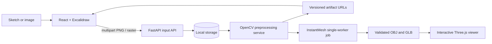

# ML_HACKATHON

# Sketch2Shape AI

Local first phase of a sketch-to-3D workspace. Users can draw with the official Excalidraw editor or upload a PNG/JPEG/WEBP. FastAPI validates and stores the original, then a modular OpenCV pipeline creates normalized, grayscale, enhanced, edge, binary, and recommended artifacts.

## Scope

Implemented: Excalidraw canvas with PNG and scene JSON export; raster upload; UUID filesystem storage; content validation; configurable synchronous OpenCV preprocessing; artifact URLs/download; local API and responsive workspace UI. Generation jobs now have persisted status, a single-worker queue, an isolated subprocess adapter for the official InstantMesh CLI, validated OBJ-to-GLB export, and download routes. Actual model generation requires the dedicated InstantMesh environment described below; it is not bundled and no generated mesh is claimed by this checkout.

## Architecture



Both input paths call the same input service and persist a PNG original. The frontend uses IDs and artifact URLs and never reads storage paths. Each preprocessing run has a distinct processing UUID and keeps all derived files plus `result.json`.

## Structure

`frontend/` React, TypeScript, Vite, Tailwind, official Excalidraw. `backend/app/api` routes; `schemas` contracts; `services` input/storage/preprocessing; `cv` image operations; `utils` validation. `storage/` is generated at runtime and ignored by Git. `docs/` contains API, architecture, pipeline, CV, frontend/backend, next phase, testing, and troubleshooting guides.

## Requirements and setup

Python 3.10+, Node 20+, npm. Setup scripts are platform-specific so each shell uses its native virtual environment and executable paths.

### Linux / macOS

```bash
./scripts/setup_linux.sh
./scripts/run_all.sh
```

Setup creates `backend/.venv`, installs pinned backend packages and frontend packages, and copies `.env.example` only if `.env` does not exist. For separate terminals, run `./scripts/run_backend.sh` and `./scripts/run_frontend.sh`. To open both, use `./scripts/run_all.sh`.

### Windows PowerShell

From PowerShell at the repository root, run `scripts\setup_windows.cmd` once. Then run `scripts\run_backend.cmd` and `scripts\run_frontend.cmd` in separate terminals, or use `scripts\run_all.cmd` to open both. Open http://127.0.0.1:5173; API docs are at http://127.0.0.1:8000/docs. The `.sh` scripts are for Linux/macOS (or WSL); PowerShell does not execute them as shell scripts.

The setup command's `Requirement already satisfied` lines are normal pip output. If npm reports that `esbuild.exe` is an invalid application, npm did not finish installing the frontend. The Windows setup script uses a project-local npm cache and prints a targeted hint for this case. Python virtualenv activation is optional; if desired in PowerShell, use `. .\backend\.venv\Scripts\Activate.ps1` (dot, space, then script path). The run scripts use the virtualenv directly, so activation is not required.

## API summary

- `GET /api/v1/health`
- `POST /api/v1/inputs/upload` multipart `file`
- `POST /api/v1/inputs/drawing` multipart `image`, optional `scene_json`, `source`
- `GET /api/v1/inputs/{input_id}`
- `POST /api/v1/inputs/{input_id}/preprocess` optional JSON config
- `GET /api/v1/inputs/{input_id}/artifacts/original.png`
- `GET /api/v1/inputs/{input_id}/processing/{processing_id}/{artifact_name}`
- `POST /api/v1/generate` (or compatibility alias `/api/v1/reconstruction`) submits a generation job
- `GET /api/v1/jobs/{job_id}` and `/result` report job state and asset formats
- `GET /api/v1/jobs/{job_id}/assets/model.glb` and `model.obj` download completed geometry

See [API_REFERENCE](docs/API_REFERENCE.md) for schemas, examples, and errors. Uploads are limited to 10 MB and 25 million pixels by default. PNG, JPEG and WEBP are decoded and verified by Pillow; suffix and image contents are both checked. Transparent images are composited onto the configurable background.

## Preprocessing

The CPU pipeline preserves a source copy as a normalized PNG original, composites alpha, downsizes without stretching, optionally denoises and applies CLAHE, then writes all intermediate representations. `enhanced` is the default recommendation and is configurable. Edges and threshold results are retained for comparison, not assumed to be universally best. Details and configuration are in [OPENCV_GUIDE](docs/OPENCV_GUIDE.md).

## Tests

```bash
cd backend && .venv/bin/python -m pytest
cd frontend && npm run build
```

See [TESTING_GUIDE](docs/TESTING_GUIDE.md). Samples can be added under `samples/sketches/`; generated user content should remain in ignored `storage/`.

## InstantMesh configuration and current limits

Preprocessing is synchronous and intended for local-sized images. Install the official TencentARC/InstantMesh checkout and dependencies in a separate Python 3.10 environment, then set `INSTANTMESH_REPO` and `INSTANTMESH_PYTHON` in `backend/.env`. The adapter invokes the upstream `run.py <config> <image> --output_path <job-output> --no_rembg` command, with a single inference worker and a configurable timeout. Install backend dependencies, including Trimesh, from `backend/requirements.txt`. Configure and measure your GPU before presenting local inference as working; generation is not claimed to have been verified on this Windows checkout. See [INSTANTMESH_INTEGRATION](docs/INSTANTMESH_INTEGRATION.md).
