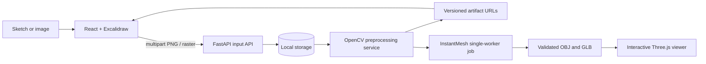

# ML_HACKATHON

# Sketch2Shape AI

Sketch-to-3D workspace. Draw one object in Excalidraw or upload a photo, optionally describe it, and click **Generate 3D**. The backend validates the image, cuts out the object with OpenCV, runs the official TencentARC InstantMesh pipeline (Zero123++ multi-view diffusion followed by mesh reconstruction) as a queued GPU job, validates and normalises the mesh, and exports a verified GLB. The browser shows real stage and diffusion-step progress, then loads the GLB in an interactive Three.js viewer with GLB/OBJ downloads.

## Scope

Implemented end to end:
- Excalidraw canvas and photo upload.
- Optional prompt, which is stored with the job but doesn't affect the geometry.
- Generation options: background handling, diffusion steps, seed, texture map.
- SQLite-backed jobs with a bounded queue, a single GPU worker, cancelling and restart recovery.
- InstantMesh subprocess adapter with failure categories (out of memory, timeout, missing weights).
- Mesh validation, Y-up normalisation and GLB export with a reload check.
- Viewer: material, clay and wireframe modes, grid, axes, reset view, full screen.
- Job history, dark mode and a responsive layout.

The InstantMesh environment is not bundled. Point `backend/.env` at your installation (see below). Until it is configured, the UI and API say so instead of producing anything fake.

## Architecture



Both input paths call the same input service and persist a PNG original. The frontend uses IDs and artifact URLs and never reads storage paths. Each preprocessing run has a distinct processing UUID and keeps all derived files plus `result.json`.

## Structure

`frontend/` React, TypeScript, Vite, Tailwind, official Excalidraw. `backend/app/api` routes; `schemas` contracts; `services` input/storage/preprocessing; `cv` image operations; `utils` validation. `storage/` is generated at runtime and ignored by Git. `docs/` contains API, architecture, pipeline, CV, frontend/backend, next phase, testing, and troubleshooting guides.

## Requirements and setup

Python 3.10+, Node 20+, npm. Setup scripts are platform-specific so each shell uses its native virtual environment and executable paths.

### Linux / macOS

```bash
./scripts/setup_linux.sh
./scripts/run_all.sh
```

Setup creates `backend/.venv`, installs pinned backend packages and frontend packages, and copies `.env.example` only if `.env` does not exist. For separate terminals, run `./scripts/run_backend.sh` and `./scripts/run_frontend.sh`. To open both, use `./scripts/run_all.sh`.

### Windows PowerShell

From PowerShell at the repository root, run `scripts\setup_windows.cmd` once. Then run `scripts\run_backend.cmd` and `scripts\run_frontend.cmd` in separate terminals, or use `scripts\run_all.cmd` to open both. Open http://127.0.0.1:5173; API docs are at http://127.0.0.1:8000/docs. The `.sh` scripts are for Linux/macOS (or WSL); PowerShell does not execute them as shell scripts.

The setup command's `Requirement already satisfied` lines are normal pip output. If npm reports that `esbuild.exe` is an invalid application, npm did not finish installing the frontend. The Windows setup script uses a project-local npm cache and prints a targeted hint for this case. Python virtualenv activation is optional; if desired in PowerShell, use `. .\backend\.venv\Scripts\Activate.ps1` (dot, space, then script path). The run scripts use the virtualenv directly, so activation is not required.

## API summary

- `GET /api/v1/health`: backend, GPU, worker and storage status
- `POST /api/v1/generate`: multipart `image` (or `input_id`), `prompt`, options → 202 with a `job_id`
- `GET /api/v1/jobs`: history. `GET /api/v1/jobs/{id}`: status, stage, progress, timings, error
- `POST /api/v1/jobs/{id}/cancel`
- `GET /api/v1/jobs/{id}/result`: model metadata. `GET /api/v1/jobs/{id}/download/glb|obj`
- `/api/v1/inputs/*`: store inputs and run the optional OpenCV analysis

See [API_REFERENCE](docs/API_REFERENCE.md) for schemas, error codes and examples. All errors use `{"success": false, "error": {"code", "message"}}`. Uploads are limited to 10 MB and 25 million pixels; PNG, JPEG and WEBP contents are decoded and verified, not just the file extension.

## Preprocessing

The CPU pipeline preserves a source copy as a normalized PNG original, composites alpha, downsizes without stretching, optionally denoises and applies CLAHE, then writes all intermediate representations. `enhanced` is the default recommendation and is configurable. Edges and threshold results are retained for comparison, not assumed to be universally best. Details and configuration are in [OPENCV_GUIDE](docs/OPENCV_GUIDE.md).

## Tests

```bash
cd backend && .venv/bin/python -m pytest
cd frontend && npm test && npm run build
```

Backend tests use an InstantMesh **test double** (`backend/tests/fixtures/fake_instantmesh`) that follows the official CLI but writes a fixed box, so the whole pipeline can be tested without a GPU. See [TESTING_GUIDE](docs/TESTING_GUIDE.md).

## InstantMesh configuration

Keep the official TencentARC/InstantMesh checkout in its own Python environment and set `INSTANTMESH_REPO` and `INSTANTMESH_PYTHON` in `backend/.env`. Each job runs `run.py <config> <image> --output_path … --diffusion_steps … --seed …` as an isolated subprocess, one at a time, so only one copy of the models is ever in VRAM. Details, progress parsing, failure handling and a remote-GPU fallback are in [INSTANTMESH_INTEGRATION](docs/INSTANTMESH_INTEGRATION.md).
