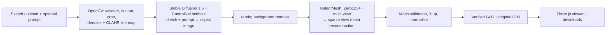

# Sketch2Shape AI

**From a 2D sketch to a 3D asset.** TechZephyr 4.0 hackathon project (IIT Bhubaneswar).

Draw one object in the browser or upload a sketch or photo, and optionally describe it. The pipeline then:
1. Cleans up the image with OpenCV.
2. Turns the sketch into a realistic object image with **Stable Diffusion 1.5 + ControlNet**, guided by your description.
3. Reconstructs a textured 3D mesh with **TencentARC InstantMesh**.
4. Validates the mesh, then exports it as a verified **GLB** (plus the original **OBJ**).

The result opens in an interactive 3D viewer and can be downloaded.



Photos skip the ControlNet step and go straight to rembg and InstantMesh. If ControlNet fails (for example it runs out of GPU memory), the job continues with the sketch cutout and says so.

## For judges

| | |
|---|---|
| **Demo video** | _Link to be added_ |
| **Demo machine** | Windows laptop, NVIDIA GeForce RTX 3050 Laptop GPU (_VRAM: fill in from `nvidia-smi`_). All generation in the video runs locally on this laptop |
| **Development machine** | Windows 11 laptop without an NVIDIA GPU. The automated tests run there with test doubles in place of the GPU models (see [Tests](#tests)) |
| **How to reproduce** | [Run it on Windows](#run-it-on-windows-step-by-step): 7 steps, all scripted |
| **Timings and resources** | [Hardware, timings and limitations](#hardware-timings-and-limitations) |

**Where the GPU work happens.** The 3D generation runs on the computer that runs the backend, and that computer needs an NVIDIA GPU. The web page itself can be opened from any device and browser: phone, tablet, Mac or Chromebook. That device doesn't need a GPU; it only displays the page and the 3D viewer. Browsers cannot run InstantMesh, whose renderer is CUDA-only, on a visitor's own GPU.

**Without an NVIDIA GPU** the app still starts. Drawing, uploading and the OpenCV analysis work, and **Generate 3D** is disabled with the exact reason, e.g. "No CUDA-capable NVIDIA GPU is visible".

## Run it on Windows (step by step)

Tested path: Windows 10/11 + NVIDIA GPU. Run these in **PowerShell** from the folder where you want the project. Total download is about 15 GB (tools, Python packages and model weights), mostly in steps 2 and 5.

**1. Install the tools** (once). Close and reopen PowerShell afterwards.

```powershell
winget install --id Git.Git
winget install --id Python.Python.3.10
winget install --id OpenJS.NodeJS.LTS
winget install --id Microsoft.VisualStudio.2022.BuildTools --override "--add Microsoft.VisualStudio.Workload.VCTools --includeRecommended --passive"
winget install --id Cloudflare.cloudflared
```

Also install the **CUDA Toolkit 12.6** from https://developer.nvidia.com/cuda-12-6-3-download-archive (use 12.8 for RTX 50-series). Use a current NVIDIA driver; `nvidia-smi` should list the GPU.

**2. Get the code and set up the app**

```powershell
git clone https://github.com/anmolkamath22/ML_HACKATHON.git
cd ML_HACKATHON
scripts\setup_windows.cmd
```

**3. Install the GPU part** (InstantMesh, PyTorch, ControlNet runtime, about 5 GB)

```powershell
scripts\setup_instantmesh_windows.cmd
```

This script:
- checks the GPU and picks the matching PyTorch build
- downloads the official InstantMesh code into `third_party\`
- fills in `backend\.env`
- compiles the nvdiffrast renderer once

If a tool from step 1 is missing, it stops and prints the command to install it.

**4. Download the models and run one test generation** (about 10 GB the first time)

```powershell
scripts\warmup_models.cmd
```

This runs ControlNet and InstantMesh once on a sample sketch. On 4 GB GPUs, if `instant-mesh-large` runs out of memory, it switches to `instant-mesh-base` automatically and saves that choice. It ends by printing the GPU, timings and peak GPU memory.

**5. Start the app**

```powershell
scripts\serve.cmd --public
```

Open the `https://….trycloudflare.com` link it prints, on this laptop or any other device. Without `--public` it prints `http://<ip>:8000` addresses, which only work on the same Wi-Fi. Keep both windows open while using it; press Ctrl+C to stop.

**6. Try it:** draw an object (or upload a sketch or photo), optionally describe it, click **Generate 3D**, then inspect and download the GLB/OBJ.

**7. Optional checks:** `cd backend; .venv\Scripts\python.exe -m pytest` and `cd frontend; npm test` (no GPU needed).

### Linux / macOS

`./scripts/setup_linux.sh`, then install InstantMesh by following its [official README](https://github.com/TencentARC/InstantMesh) and set `INSTANTMESH_REPO` and `INSTANTMESH_PYTHON` in `backend/.env`. In the InstantMesh environment, also run `pip install accelerate` for ControlNet. Start with `./scripts/serve.sh --public`. macOS cannot generate (no NVIDIA GPU) but can open the page from another machine. Details: [InstantMesh setup](docs/INSTANTMESH_INTEGRATION.md).

### Ways to run

| Goal | Windows · Linux | Open |
|---|---|---|
| Anyone, any device, any network | `scripts\serve.cmd --public` · `./scripts/serve.sh --public` | The `https://….trycloudflare.com` link it prints |
| Devices on the same Wi-Fi/LAN | `scripts\serve.cmd` · `./scripts/serve.sh` | The `http://<ip>:8000` address it prints |
| Develop with hot reload | `scripts\run_all.cmd` · `./scripts/run_all.sh` | `http://127.0.0.1:5173` |

About the public link:
- It uses a free Cloudflare quick tunnel (no account needed).
- It changes each time you start it.
- It only works while the laptop runs the app.
- Anyone who has it can use the GPU, so share it only for the demo.

In LAN mode on Windows, allow Python through the firewall for private networks when asked. API docs are at `/docs` on the same address.

## GPU support

Generate 3D is enabled only when the InstantMesh environment's own PyTorch reports a usable GPU. The backend checks this at startup with `backend/inference_scripts/gpu_probe.py` instead of a fixed list of models.

| GPU | Works? | Why |
|---|---|---|
| NVIDIA GeForce RTX 20/30/40-series, laptop or desktop (2050, 3050, 4050, 4060, …), and other CUDA cards | **Yes** | InstantMesh and ControlNet need CUDA. 4 GB works with ControlNet's CPU offload; 6–8 GB or more is faster and more reliable |
| NVIDIA RTX 50-series (5050, …) | Yes, **with a recent PyTorch** (CUDA 12.8 builds) | The PyTorch 2.1 used by the official InstantMesh setup has no kernels for these GPUs; the app detects this and says so |
| AMD (ROCm), Intel, Apple Silicon (MPS) | **No** | InstantMesh's mesh renderer (nvdiffrast/FlexiCubes) is CUDA-only. The app detects these and explains why |
| No GPU | No | Drawing, upload and OpenCV analysis still work |

The GPU stages run one at a time as separate processes, so ControlNet's memory is freed before InstantMesh starts. ControlNet switches to CPU offload automatically below 8 GB VRAM (`CONTROLNET_MEMORY`). If `instant-mesh-large` runs out of memory on a small card, set `INSTANTMESH_CONFIG=configs/instant-mesh-base.yaml`.

## Using it

1. Draw one object (Excalidraw: pencil, shapes, eraser, Clear) or upload a PNG/JPG/WEBP sketch or photo.
2. Optionally describe it, e.g. "a red ceramic teapot". The description guides colour, material and style of the ControlNet image. The shape comes from the sketch.
3. Optional settings:
   - **AI refinement:** Auto, On or Off. Auto turns it on for drawings and uploaded sketches.
   - **Background handling.**
   - **Quality:** InstantMesh diffusion steps.
   - **Seed.**
   - **Texture map export.**
4. Click **Generate 3D**. The job panel shows each stage with real step counts, the ControlNet line map and image, and the Zero123++ views.
5. Inspect the model (orbit, zoom, pan, material, clay or wireframe view, grid, axes, full screen), then download the GLB or OBJ. **Generate another** keeps your drawing; **History** reopens earlier jobs.

## Hardware, timings and limitations

Every job records its stage timings, peak GPU memory and peak inference RAM. These appear in the result panel and in `GET /api/v1/jobs/{id}/result`.

| Measured on | InstantMesh model | ControlNet | InstantMesh | Mesh + GLB | Total | Peak VRAM |
|---|---|---|---|---|---|---|
| Windows, RTX 3050 Laptop GPU (_VRAM_), _RAM: fill in_ | _fill in_ | _fill in_ | _fill in_ | _fill in_ | _fill in_ | _fill in_ |

To fill in this row, generate a model in the app and copy the numbers from the result panel. Use a run after `warmup_models.cmd`, so model downloads don't count.

**4–6 GB laptop GPUs (RTX 2050, RTX 3050 and similar):**
- ControlNet automatically offloads parts of the model to system RAM.
- If `instant-mesh-large` doesn't fit, the warm-up switches to `instant-mesh-base`.
- On Windows, keep the NVIDIA driver's **CUDA - Sysmem Fallback Policy** (NVIDIA Control Panel → Manage 3D settings) at its default, *Driver Default* or *Prefer Sysmem Fallback*. Then a run that exceeds VRAM slows down instead of failing.
- Close games and other GPU-heavy apps while generating.
- Generation takes minutes, not seconds, on these GPUs.

Known limitations:
- **Hidden sides are a guess.** A single view does not show them, so InstantMesh infers them.
- **Sketch quality matters.** Results are best for one clearly drawn object from a three-quarter view. Rough or overlapping strokes can produce merged or flat shapes.
- **The prompt changes appearance, not shape.** It steers colour, material and style through ControlNet; InstantMesh itself has no text input.
- **Small GPUs are slower and can run out of memory.** With 4 GB, ControlNet uses CPU offload and `instant-mesh-large` may not fit (use `instant-mesh-base`).
- **The first run downloads model weights** (about 10 GB).
- **Not production assets.** Output is meant for exploration, not 3D printing or animation. Both are outside the problem statement's scope.

## Architecture and API

The frontend is React, TypeScript and Vite with Excalidraw and Three.js (React Three Fiber). The backend is FastAPI with OpenCV and trimesh, plus a SQLite job store and one GPU worker.

| Endpoint | Purpose |
|---|---|
| `GET /api/v1/health` | GPU, inference readiness, worker and storage status |
| `POST /api/v1/generate` | Image or `input_id`, prompt and options → 202 with a `job_id` |
| `GET /api/v1/jobs`, `GET /api/v1/jobs/{id}`, `POST …/cancel` | History, status/stage/progress, cancel |
| `GET /api/v1/jobs/{id}/result`, `GET …/download/glb\|obj` | Model metadata and downloads |

Details: [Architecture](docs/ARCHITECTURE.md) · [API reference](docs/API_REFERENCE.md) · [InstantMesh and ControlNet](docs/INSTANTMESH_INTEGRATION.md) · [Testing](docs/TESTING_GUIDE.md) · [Troubleshooting](docs/TROUBLESHOOTING.md)

## Tests

```bash
cd backend && .venv/bin/python -m pytest      # Windows: .venv\Scripts\python.exe -m pytest
cd frontend && npm test && npm run build
```

The tests run without a GPU. They replace the GPU stages with **test doubles** in `backend/tests/fixtures/`, which follow the real command-line interfaces but produce fixed outputs. These prove the plumbing, not the model quality.

## Pretrained models and third-party components

| Component | Used for | Source | License |
|---|---|---|---|
| InstantMesh (TencentARC) | Image → 3D mesh | [github.com/TencentARC/InstantMesh](https://github.com/TencentARC/InstantMesh) | Apache-2.0 (code); see the repo for model terms |
| Zero123++ v1.2 | Multi-view images inside InstantMesh | [github.com/SUDO-AI-3D/zero123plus](https://github.com/SUDO-AI-3D/zero123plus) | See the repo |
| Stable Diffusion 1.5 | Sketch → image base model | [huggingface.co/stable-diffusion-v1-5/stable-diffusion-v1-5](https://huggingface.co/stable-diffusion-v1-5/stable-diffusion-v1-5) | CreativeML OpenRAIL-M |
| ControlNet v1.1 scribble | Keeps the image faithful to the sketch | [huggingface.co/lllyasviel/control_v11p_sd15_scribble](https://huggingface.co/lllyasviel/control_v11p_sd15_scribble) | See the model card |
| rembg | Background removal (inside InstantMesh) | [github.com/danielgatis/rembg](https://github.com/danielgatis/rembg) | MIT |
| Hugging Face diffusers, PyTorch | Model runtime | huggingface/diffusers, pytorch/pytorch | Apache-2.0, BSD-3-Clause |
| OpenCV, Pillow, NumPy, trimesh | Image preparation, mesh validation and export | opencv.org, python-pillow, numpy, mikedh/trimesh | Apache-2.0, MIT-CMU, BSD, MIT |
| FastAPI, Uvicorn | API server | tiangolo/fastapi, encode/uvicorn | MIT, BSD-3-Clause |
| Excalidraw, React, Three.js, React Three Fiber/drei | Drawing canvas, UI, 3D viewer | excalidraw, facebook/react, mrdoob/three.js, pmndrs | MIT |

No paid or external inference APIs are used. All models run locally on the machine running the backend.
