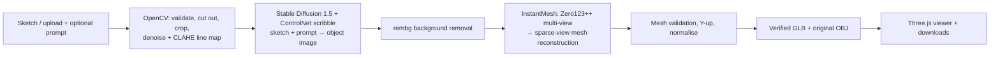

# Sketch2Shape AI

**From a 2D sketch to a 3D asset.** TechZephyr 4.0 hackathon project (IIT Bhubaneswar).

Draw one object in the browser or upload a sketch or photo, and optionally describe it. The pipeline then:
1. Cleans up the image with OpenCV.
2. Turns the sketch into a realistic object image with **Stable Diffusion 1.5 + ControlNet**, guided by your description.
3. Reconstructs a textured 3D mesh with **TencentARC InstantMesh**.
4. Validates the mesh, then exports it as a verified **GLB** (plus the original **OBJ**).

The result opens in an interactive 3D viewer and can be downloaded.



Photos skip the ControlNet step and go straight to rembg and InstantMesh. If ControlNet fails (for example it runs out of GPU memory), the job continues with the sketch cutout and says so.

## Requirements

| | Needed for | Notes |
|---|---|---|
| Python 3.10+ and Node.js 20+ | The app (UI + API) | Windows, Linux or macOS |
| An **NVIDIA GPU with CUDA** | Generate 3D | Any CUDA GPU PyTorch supports; see [GPU support](#gpu-support) |
| InstantMesh in its own Python 3.10 environment | Generate 3D | [Official repo](https://github.com/TencentARC/InstantMesh); that environment also needs `diffusers` and `accelerate` for ControlNet |
| ~10 GB disk and internet on first run | Model weights | InstantMesh, Zero123++, SD 1.5 and ControlNet download from Hugging Face |

Without a supported GPU the app still runs: you can draw, upload and inspect the OpenCV analysis, and Generate 3D is disabled with the exact reason.

## Quick start

```bash
# Linux / macOS
./scripts/setup_linux.sh          # backend venv + frontend packages + backend/.env
# Windows (PowerShell or cmd)
scripts\setup_windows.cmd
```

Set `INSTANTMESH_REPO` and `INSTANTMESH_PYTHON` in `backend/.env` (see [InstantMesh setup](docs/INSTANTMESH_INTEGRATION.md)). Then choose how to run it:

| Goal | Command (Linux/macOS · Windows) | Open |
|---|---|---|
| **Anyone, any device, any network** (judges, phones on mobile data) | `./scripts/serve.sh --public` · `scripts\serve.cmd --public` | The `https://….trycloudflare.com` link it prints |
| Devices on the **same Wi-Fi/LAN** | `./scripts/serve.sh` · `scripts\serve.cmd` | The `http://<ip>:8000` address it prints |
| Develop with hot reload | `./scripts/run_all.sh` · `scripts\run_all.cmd` | `http://127.0.0.1:5173` |

`serve` builds the UI and serves it together with the API from one port. Any device with a modern browser (Chrome, Edge, Firefox or Safari on Windows, macOS, Linux, Android or iOS) can open it, and the device needs no GPU. Only the computer running `serve` needs one, and that computer must stay on and connected while others use the link.

`--public` uses a free Cloudflare quick tunnel and needs the `cloudflared` tool installed once: `winget install --id Cloudflare.cloudflared` on Windows, `brew install cloudflared` on macOS, or the `.deb` from [cloudflared releases](https://github.com/cloudflare/cloudflared/releases) on Ubuntu. No account is needed. The link changes each time you start it, and anyone who has it can use your GPU, so share it only for the demo. On Windows, allow Python through the firewall for private networks when asked (LAN mode).

API docs: `http://<host>:8000/docs`.

## GPU support

Generate 3D is enabled only when the InstantMesh environment's own PyTorch reports a usable GPU. The backend checks this at startup with `backend/inference_scripts/gpu_probe.py` instead of a fixed list of models.

| GPU | Works? | Why |
|---|---|---|
| NVIDIA GeForce RTX 20/30/40-series, laptop or desktop (2050, 3050, 4050, 4060, …), and other CUDA cards | **Yes** | InstantMesh and ControlNet need CUDA. 4 GB works with ControlNet's CPU offload; 6–8 GB or more is faster and more reliable |
| NVIDIA RTX 50-series (5050, …) | Yes, **with a recent PyTorch** (CUDA 12.8 builds) | The PyTorch 2.1 used by the official InstantMesh setup has no kernels for these GPUs; the app detects this and says so |
| AMD (ROCm), Intel, Apple Silicon (MPS) | **No** | InstantMesh's mesh renderer (nvdiffrast/FlexiCubes) is CUDA-only. The app detects these and explains why |
| No GPU | No | Drawing, upload and OpenCV analysis still work |

The GPU stages run one at a time as separate processes, so ControlNet's memory is freed before InstantMesh starts. ControlNet switches to CPU offload automatically below 8 GB VRAM (`CONTROLNET_MEMORY`). If `instant-mesh-large` runs out of memory on a small card, set `INSTANTMESH_CONFIG=configs/instant-mesh-base.yaml`.

## Using it

1. Draw one object (Excalidraw: pencil, shapes, eraser, Clear) or upload a PNG/JPG/WEBP sketch or photo.
2. Optionally describe it, e.g. "a red ceramic teapot". The description guides colour, material and style of the ControlNet image. The shape comes from the sketch.
3. Optional settings:
   - **AI refinement:** Auto, On or Off. Auto turns it on for drawings and uploaded sketches.
   - **Background handling.**
   - **Quality:** InstantMesh diffusion steps.
   - **Seed.**
   - **Texture map export.**
4. Click **Generate 3D**. The job panel shows each stage with real step counts, the ControlNet line map and image, and the Zero123++ views.
5. Inspect the model (orbit, zoom, pan, material, clay or wireframe view, grid, axes, full screen), then download the GLB or OBJ. **Generate another** keeps your drawing; **History** reopens earlier jobs.

## Hardware, timings and limitations

Every job records its stage timings, peak GPU memory and peak inference RAM. These appear in the result panel and in `GET /api/v1/jobs/{id}/result`.

| Measured on | ControlNet | InstantMesh | Mesh + GLB | Total | Peak VRAM |
|---|---|---|---|---|---|
| _To fill in from a real run on the GPU laptop_ | | | | | |

Known limitations:
- **Hidden sides are a guess.** A single view does not show them, so InstantMesh infers them.
- **Sketch quality matters.** Results are best for one clearly drawn object from a three-quarter view. Rough or overlapping strokes can produce merged or flat shapes.
- **The prompt changes appearance, not shape.** It steers colour, material and style through ControlNet; InstantMesh itself has no text input.
- **Small GPUs are slower and can run out of memory.** With 4 GB, ControlNet uses CPU offload and `instant-mesh-large` may not fit (use `instant-mesh-base`).
- **The first run downloads model weights** (about 10 GB).
- **Not production assets.** Output is meant for exploration, not 3D printing or animation. Both are outside the problem statement's scope.

## Architecture and API

The frontend is React, TypeScript and Vite with Excalidraw and Three.js (React Three Fiber). The backend is FastAPI with OpenCV and trimesh, plus a SQLite job store and one GPU worker.

| Endpoint | Purpose |
|---|---|
| `GET /api/v1/health` | GPU, inference readiness, worker and storage status |
| `POST /api/v1/generate` | Image or `input_id`, prompt and options → 202 with a `job_id` |
| `GET /api/v1/jobs`, `GET /api/v1/jobs/{id}`, `POST …/cancel` | History, status/stage/progress, cancel |
| `GET /api/v1/jobs/{id}/result`, `GET …/download/glb\|obj` | Model metadata and downloads |

Details: [Architecture](docs/ARCHITECTURE.md) · [API reference](docs/API_REFERENCE.md) · [InstantMesh and ControlNet](docs/INSTANTMESH_INTEGRATION.md) · [Testing](docs/TESTING_GUIDE.md) · [Troubleshooting](docs/TROUBLESHOOTING.md)

## Tests

```bash
cd backend && .venv/bin/python -m pytest      # Windows: .venv\Scripts\python.exe -m pytest
cd frontend && npm test && npm run build
```

The tests run without a GPU. They replace the GPU stages with **test doubles** in `backend/tests/fixtures/`, which follow the real command-line interfaces but produce fixed outputs. These prove the plumbing, not the model quality.

## Pretrained models and third-party components

| Component | Used for | Source | License |
|---|---|---|---|
| InstantMesh (TencentARC) | Image → 3D mesh | [github.com/TencentARC/InstantMesh](https://github.com/TencentARC/InstantMesh) | Apache-2.0 (code); see the repo for model terms |
| Zero123++ v1.2 | Multi-view images inside InstantMesh | [github.com/SUDO-AI-3D/zero123plus](https://github.com/SUDO-AI-3D/zero123plus) | See the repo |
| Stable Diffusion 1.5 | Sketch → image base model | [huggingface.co/stable-diffusion-v1-5/stable-diffusion-v1-5](https://huggingface.co/stable-diffusion-v1-5/stable-diffusion-v1-5) | CreativeML OpenRAIL-M |
| ControlNet v1.1 scribble | Keeps the image faithful to the sketch | [huggingface.co/lllyasviel/control_v11p_sd15_scribble](https://huggingface.co/lllyasviel/control_v11p_sd15_scribble) | See the model card |
| rembg | Background removal (inside InstantMesh) | [github.com/danielgatis/rembg](https://github.com/danielgatis/rembg) | MIT |
| Hugging Face diffusers, PyTorch | Model runtime | huggingface/diffusers, pytorch/pytorch | Apache-2.0, BSD-3-Clause |
| OpenCV, Pillow, NumPy, trimesh | Image preparation, mesh validation and export | opencv.org, python-pillow, numpy, mikedh/trimesh | Apache-2.0, MIT-CMU, BSD, MIT |
| FastAPI, Uvicorn | API server | tiangolo/fastapi, encode/uvicorn | MIT, BSD-3-Clause |
| Excalidraw, React, Three.js, React Three Fiber/drei | Drawing canvas, UI, 3D viewer | excalidraw, facebook/react, mrdoob/three.js, pmndrs | MIT |

No paid or external inference APIs are used. All models run locally on the machine running the backend.
