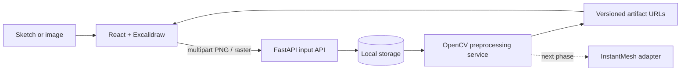

# Sketch2Shape AI

Local first phase of a sketch-to-3D workspace. Users can draw with the official Excalidraw editor or upload a PNG/JPEG/WEBP. FastAPI validates and stores the original, then a modular OpenCV pipeline creates normalized, grayscale, enhanced, edge, binary, and recommended artifacts.

## Scope

Implemented: Excalidraw canvas with PNG and scene JSON export; raster upload; UUID filesystem storage; content validation; configurable synchronous OpenCV preprocessing; artifact URLs/download; local API and responsive workspace UI. The reconstruction endpoint is an honest HTTP 501 placeholder. InstantMesh, model generation, user accounts, and background jobs are planned and not implemented. Automated backend tests are present; execution status is recorded in the handoff report.

## Architecture



Both input paths call the same input service and persist a PNG original. The frontend uses IDs and artifact URLs and never reads storage paths. Each preprocessing run has a distinct processing UUID and keeps all derived files plus `result.json`.

## Structure

`frontend/` React, TypeScript, Vite, Tailwind, official Excalidraw. `backend/app/api` routes; `schemas` contracts; `services` input/storage/preprocessing; `cv` image operations; `utils` validation. `storage/` is generated at runtime and ignored by Git. `docs/` contains API, architecture, pipeline, CV, frontend/backend, next phase, testing, and troubleshooting guides.

## Requirements and setup

Python 3.10+, Node 20+, npm. From the repository root on Linux/macOS:

```bash
./scripts/setup_linux.sh
./scripts/run_all.sh
```

Setup creates `backend/.venv`, installs pinned backend packages and frontend packages, and copies `.env.example` only if `.env` does not exist. For separate terminals, run `./scripts/run_backend.sh` and `./scripts/run_frontend.sh`. API docs: http://127.0.0.1:8000/docs. Frontend: http://127.0.0.1:5173.

## API summary

- `GET /api/v1/health`
- `POST /api/v1/inputs/upload` multipart `file`
- `POST /api/v1/inputs/drawing` multipart `image`, optional `scene_json`, `source`
- `GET /api/v1/inputs/{input_id}`
- `POST /api/v1/inputs/{input_id}/preprocess` optional JSON config
- `GET /api/v1/inputs/{input_id}/artifacts/original.png`
- `GET /api/v1/inputs/{input_id}/processing/{processing_id}/{artifact_name}`
- `POST /api/v1/reconstruction` returns 501 by design

See [API_REFERENCE](docs/API_REFERENCE.md) for schemas, examples, and errors. Uploads are limited to 10 MB and 25 million pixels by default. PNG, JPEG and WEBP are decoded and verified by Pillow; suffix and image contents are both checked. Transparent images are composited onto the configurable background.

## Preprocessing

The CPU pipeline preserves a source copy as a normalized PNG original, composites alpha, downsizes without stretching, optionally denoises and applies CLAHE, then writes all intermediate representations. `enhanced` is the default recommendation and is configurable. Edges and threshold results are retained for comparison, not assumed to be universally best. Details and configuration are in [OPENCV_GUIDE](docs/OPENCV_GUIDE.md).

## Tests

```bash
cd backend && .venv/bin/python -m pytest
cd frontend && npm run build
```

See [TESTING_GUIDE](docs/TESTING_GUIDE.md). Samples can be added under `samples/sketches/`; generated user content should remain in ignored `storage/`.

## Known limits and next phase

Preprocessing is synchronous and intended for local-sized images. No actual 3D reconstruction is present. The next phase should implement `reconstruction_service` to resolve a selected artifact internally and add a typed response/job model; the existing input and artifact contracts can remain unchanged. Read [INSTANTMESH_INTEGRATION](docs/INSTANTMESH_INTEGRATION.md).
