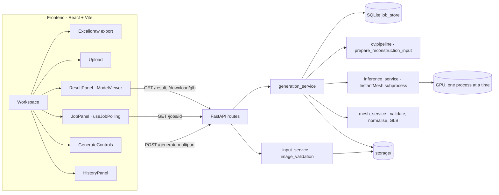

# Architecture



| Module | Responsibility |
|---|---|
| `api/routes.py` | HTTP transport only: validation, error mapping, file responses |
| `services/input_service.py` | Decode and verify the uploaded image and store `inputs/<id>/original.png` |
| `services/generation_service.py` | Job lifecycle: queue, single worker, stages, cancel, restart recovery, public job view |
| `services/job_store.py` | SQLite (`storage/jobs.db`, WAL) with atomic status changes |
| `services/inference_service.py` | InstantMesh CLI adapter: progress, timeouts, cancelling, failure categories, VRAM and RAM sampling |
| `services/mesh_service.py` | OBJ checks, cleanup, Y-up conversion, normalisation, GLB export with reload check |
| `cv/pipeline.py` | OpenCV analysis artifacts and the reconstruction input (cutout or rembg pass-through) |
| `utils/gpu.py` | `nvidia-smi` queries (the backend env has no torch) |

## Storage layout

```
storage/
  jobs.db                      job records
  inputs/<input_id>/           original.png, metadata.json, scene.json
  processed/<input_id>/<id>/   optional OpenCV analysis artifacts
  jobs/<job_id>/               input.png, request.json (prompt + options), reconstruction_input.png,
                               preprocessing.json, inference.log, instantmesh/ (raw output, untouched),
                               multiview.png, model.glb, model_obj.zip (textured only)
```

All paths are built from server-generated UUIDs and allow-listed file names. The browser never sees or supplies a filesystem path.
