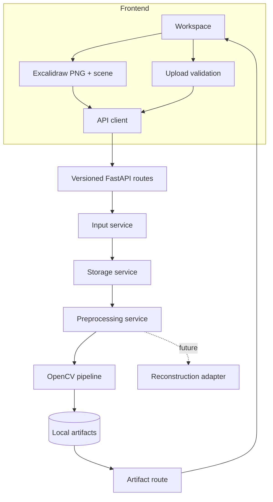

# Architecture

The React/Vite UI owns editor/upload interaction and consumes API URLs. Excalidraw is the official package; the imperative API exports PNG and scene JSON. FastAPI routes in `backend/app/api/routes.py` validate multipart transport and call services. Pydantic models define requests/responses. Input service verifies bytes and writes canonical `original.png` plus metadata. Storage service owns UUID-scoped directories. The CV pipeline is a set of reusable functions called by preprocessing service; every run gets a new UUID and manifest. Errors become HTTP responses without leaking local paths.

Configuration comes from environment and `.env`; no database or external runtime service is required. Future reconstruction should depend on a selected artifact resolver, not on the input origin or OpenCV internals.
