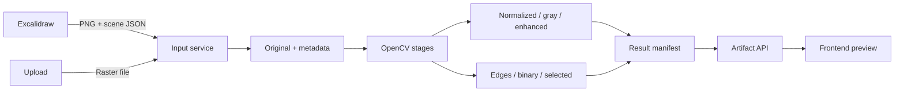

# Pipeline guide

Drawing and upload converge at `POST /inputs/...`; both are decoded, validated, stored as canonical `original.png`, and described in `metadata.json`. Input UUID links the original to later runs. The UI requests preprocessing; service creates a separate processing UUID, calls `cv/pipeline.py`, writes seven images and `result.json`, and returns public artifact URLs. The UI uses these URLs for previews/downloads.

Failures are returned as errors; the manifest is written after successful image outputs. The original endpoint points only to the canonical stored input and remains unchanged across processing runs.
